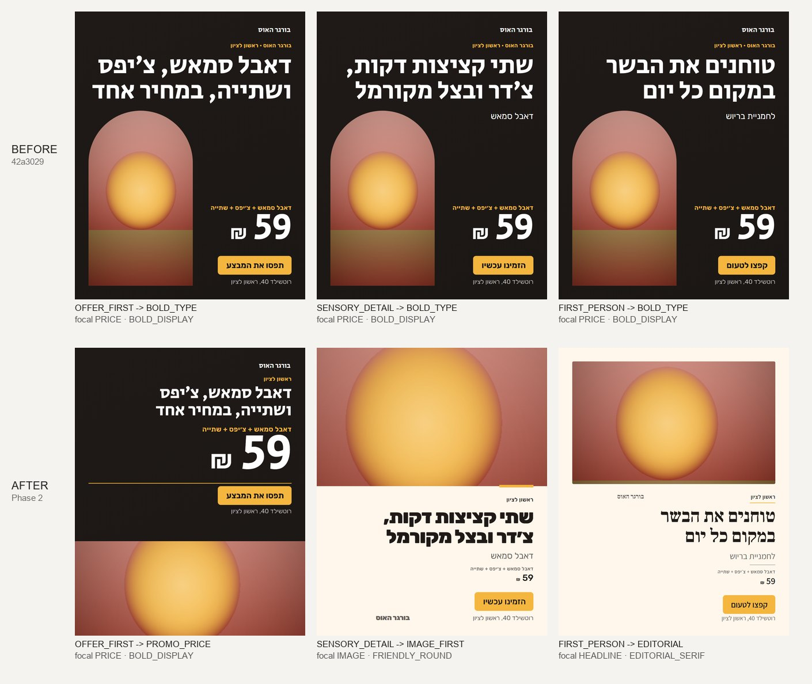

# Creative 3.0 / Phase 2: concept-driven art direction, burger sample

Fictional business (בורגר האוס), the three Phase 1 OFFER concepts, the same copy, price and ONE shared stand-in picture
(the mock image provider's gradient-and-disc PNG, labelled `SYNTHETIC_AI`; the repository has no burger photos). Mock
providers only. Regenerate: `npx tsc -b tsconfig.packages.json && node scripts/creative-art-sample.mjs --out=<dir>`.

**Before (42a3029):** all three concepts were recommended the same direction: `BOLD_TYPE`, price as the focal point,
the same arch picture and the same type. The goal (OFFER) set the layout, not the concept. The Critic passed all three.

**After:** each concept's visual idea (`CONCEPT_VISUAL_STRATEGIES` in `agent-expertise/src/art-direction.ts`) picks the
direction, arrangement, lead moves, focal point and price treatment. References still vote on the remaining moves and
the type.

| Concept | Idea | Direction / method | Focal | Price |
| --- | --- | --- | --- | --- |
| המחיר הוא החדשות | VALUE | BOLD_GRAPHIC / PROMO_PRICE | price | hero, rule line, button |
| רגע החשק | APPETITE | IMAGE_LED / IMAGE_FIRST, macro crop | picture | quiet |
| מה שקורה במטבח | CRAFT | EDITORIAL_TYPE / EDITORIAL, serif, inset frame | headline | footnote |

## Evaluation (by eye and by measurement; not a professional sign-off)

1. **Does each design communicate its concept?** Value and craft: yes. Appetite: partly. The picture leads, but it fills
   only 48% of the page (Critic, heuristic), and eight text layers remain on a "minimal copy" design.
2. **Are the three directions meaningfully different?** Yes: different arrangement, focal point, type system, palette
   and price scale. The new cross-concept check (`reviewConceptSpread`) passes this set. The before set shared one method, which the check reports (covered by a unit test; it was not run on the old code).
3. **Is the product presented effectively?** Can't be judged: the stand-in is not food. The value ad's crop keeps 73% of
   the subject (Critic, measured).
4. **Does the hierarchy support the message?** Yes in all three by measurement (price ≥ headline only in value; headline
   leads in craft).
5. **Does it avoid generic-template styling?** Mostly. All three still use the same rounded yellow CTA button, though
   the concept strategies ask for a text-line CTA on appetite and craft. The concept leads with at most four moves, and the reference vote filled the fifth slot differently.

## Unresolved

- Appetite: the picture is not full-bleed because the stand-in has no calm area, so a cream panel takes the lower half
  and leaves empty space beside the wordmark.
- The CTA treatment repeats across concepts (see 5).
- No visual-AI inspection: the Critic judges only what it can measure from the composed spec and the recorded picture
  metadata. Seeing the rendered pixels needs a paid vision call, which this phase did not make; the existing adapter is
  unchanged.
