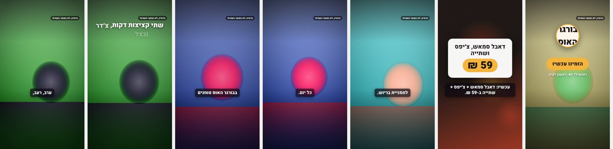

# Creative 3.0 / Phase 3: concept-driven video direction, burger preview

Fictional בורגר האוס, the three Phase 1–2 concepts. Mock providers only. The business has no media, so each
photographic scene gets a mock stand-in, approved as the studio does with `IMAGE_PROVIDER=mock` and labelled on screen.
Narration is a silent placeholder at the estimated Hebrew speech length. Regenerate:
`npx tsc -b tsconfig.packages.json && node scripts/creative-video-sample.mjs [--concept=VALUE|APPETITE|CRAFT]`.

**Before:** every concept got the same storyboard (hook, product, offer, storefront), the same moves and the same cuts.

**After:** the concept's visual idea picks a video treatment (`CONCEPT_VIDEO_TREATMENTS`, video-direction 1.1.0):
the beats, the opening, the pacing, the cut, the motion strength, when text enters and the end frame. The storyboard
prompt receives the treatment; the timeline applies it.

| Concept | Treatment | Scenes | Cuts | Motion | Text enters |
| --- | --- | --- | --- | --- | --- |
| המחיר הוא החדשות | VALUE | close-up hook, offer contents, price card, product + CTA | zoom | 0.5 | at once |
| רגע החשק | APPETITE | macro hook, whole product, bite detail, quiet price, product + CTA | hard cut | 0.6 | after 0.6 s |
| מה שקורה במטבח | CRAFT | hands, making, finished product, price, kitchen | fade | 0.35 | after 0.3 s |

**Timing (estimated, not listened to):** every line fits its scene. Captions run at 0.8–2.3 words/s in chunks of up to four
words; the hook lands at 3.1 s (craving) and 3.8 s (value).

**Asset honesty:** a non-own picture in a product, place or people scene gets an on-screen label. The plan's `shotList`
names every missing authentic shot with a phone instruction. In this run all four photographic scenes were stand-ins.

## Shortcomings caused by missing footage

- The stand-ins are coloured discs, so appetite, texture and craft can't be judged at all.
- Without real clips, "process" and "bite" beats are still images with a camera move. No subject motion is shown.
- The craft "making" beat shrinks to 2.7 s because its line is short, and the timing follows the narration.
